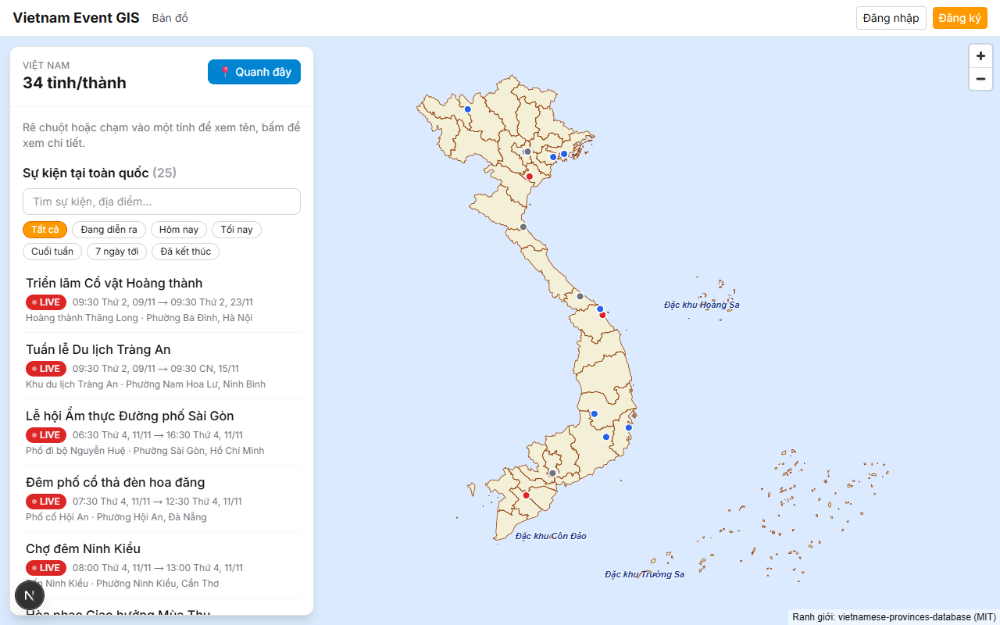
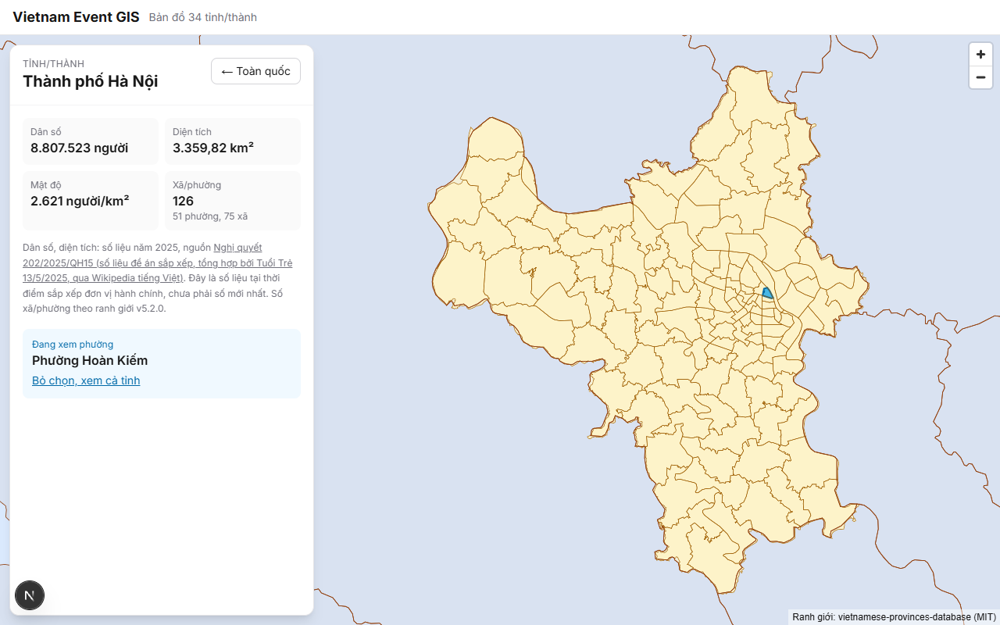
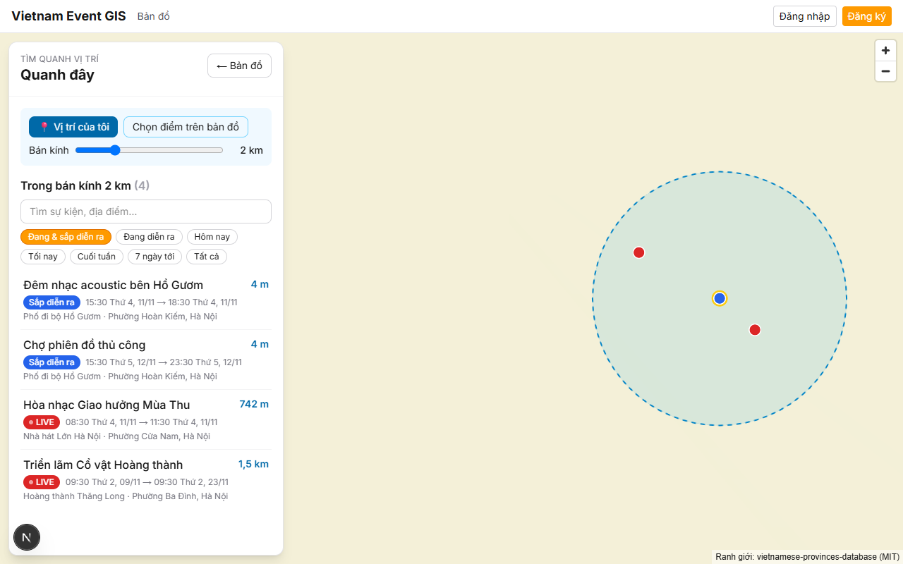
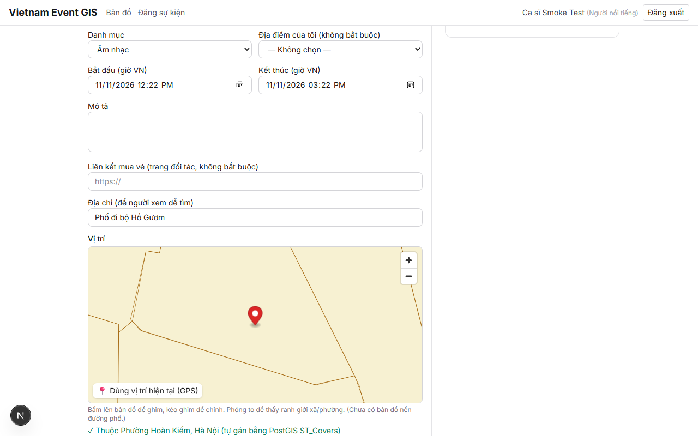
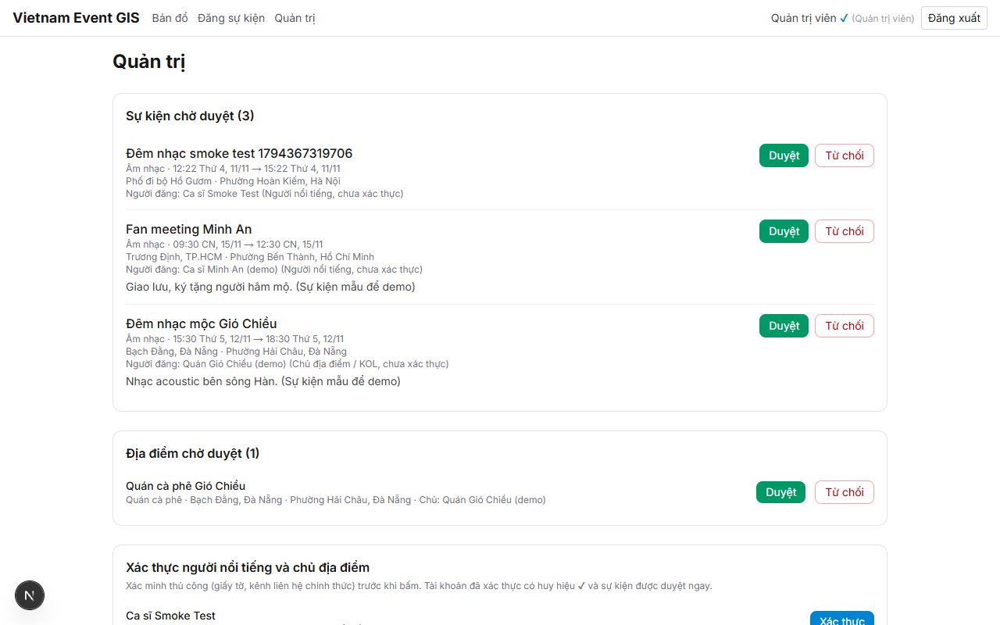

# Vietnam Event GIS

Bản đồ tương tác sự kiện và địa điểm trên **34 tỉnh/thành Việt Nam** (chính quyền 2 cấp: tỉnh và xã/phường).
Mọi sự kiện được ghim đúng vị trí, tự gán đúng tỉnh và xã/phường bằng PostGIS, và thông tin hành chính có ghi nguồn.

> Dự án demo (Giai đoạn 1 – MVP). Sự kiện trong dữ liệu mẫu là hư cấu, chỉ vị trí là địa điểm có thật.



## Tính năng

- **Bản đồ 34 tỉnh/thành**, có đầy đủ quần đảo **Hoàng Sa** (thuộc Đà Nẵng) và **Trường Sa** (thuộc Khánh Hòa). Không dùng bản đồ nền, chỉ vẽ ranh giới từ dữ liệu của dự án.
- **Rê chuột** vào tỉnh: tỉnh sáng lên và hiện tên. **Thiết bị cảm ứng**: chạm lần 1 xem tên, chạm lần 2 chọn.
- **Bấm tỉnh**: phóng vào tỉnh, làm mờ tỉnh khác, nạp ranh giới xã/phường của riêng tỉnh đó, mở **bảng thông tin** (dân số, diện tích, mật độ, số xã/phường, ghi năm và nguồn) và **danh sách sự kiện** của cả tỉnh.
- **Bấm xã/phường**: xem sự kiện của xã/phường đó.
- **Sự kiện**: trạng thái *Sắp diễn ra / Đang diễn ra (Live) / Đã kết thúc* tự tính từ thời gian; bộ lọc thời gian (hôm nay, tối nay, cuối tuần, 7 ngày tới…); tìm kiếm không phân biệt dấu.
- **Chỉ đường**: mở Google Maps tới vị trí sự kiện (chọn xe máy / ô tô / đi bộ), không cần khóa API, không lấy vị trí người dùng.
- **Quanh đây**: tìm sự kiện trong bán kính 1–5 km quanh vị trí của bạn (GPS hoặc chọn trên bản đồ), xếp gần đến xa. Tọa độ chỉ gửi lên để truy vấn, không lưu.
- **Tài khoản**: đăng ký (người dùng, người nổi tiếng, chủ địa điểm/KOL), đăng nhập.
- **Đăng sự kiện và địa điểm**: ghim trên bản đồ hoặc dùng GPS; máy chủ kiểm tra điểm có nằm trong ranh giới bằng `ST_Covers` và tự gán tỉnh, xã/phường.
- **Quản trị**: duyệt sự kiện/địa điểm, xác thực người nổi tiếng và chủ địa điểm, nhật ký kiểm duyệt.

| Chọn tỉnh và xã/phường | Quanh đây |
| --- | --- |
|  |  |

| Đăng sự kiện (kiểm tra ranh giới) | Quản trị |
| --- | --- |
|  |  |

## Công nghệ

| Phần | Công nghệ |
| --- | --- |
| Giao diện (`web/`) | Next.js 16 (App Router), React 19, TypeScript, Tailwind CSS 4, MapLibre GL JS 6 |
| API (`api/`) | Node.js 24, Express 5, TypeScript, zod (kiểm tra dữ liệu), JWT + bcrypt (đăng nhập) |
| CSDL | PostgreSQL 16 + PostGIS 3.4 chạy bằng Docker Compose |
| Kiểm thử | `node:test` cho API; puppeteer-core điều khiển Edge/Chrome cho giao diện |

Một số kỹ thuật GIS chính:

- Tọa độ WGS84 (EPSG:4326). Ranh giới lưu `geometry(MultiPolygon)`, vị trí sự kiện lưu `geography(Point)`, đều có chỉ mục **GiST**.
- **Gán tỉnh, xã/phường**: `ST_Covers(ward.geom, point)` (tính cả điểm nằm trên đường biên); nếu điểm rơi vào khe hở nhỏ giữa 2 xã do ranh giới đã đơn giản hóa thì lấy xã gần nhất trong vòng 100 m.
- **Quanh đây**: `ST_DWithin(location, point, bán_kính)` trên cột geography, sắp xếp theo `ST_Distance`.
- Mỗi sự kiện lưu `boundary_version` (phiên bản bộ ranh giới đã dùng khi gán tỉnh/xã).
- Ranh giới được **đơn giản hóa** bằng thuật toán Douglas–Peucker (tự viết, `scripts/lib/geo-simplify.mjs`): tỉnh từ 92.875 xuống 23.256 điểm (480 KB); xã/phường tách mỗi tỉnh 1 file, chỉ tải khi người dùng chọn tỉnh.

## Cấu trúc thư mục

```
api/                 REST API (Express + PostgreSQL/PostGIS)
  db/migrations/     Các file SQL tạo bảng, chạy theo thứ tự
  scripts/           migrate, nạp ranh giới, dữ liệu mẫu
  src/routes/        Các nhóm đường dẫn API (provinces, events, auth, submit, admin)
  test/              Kiểm thử API
web/                 Giao diện Next.js
  public/geo/        GeoJSON tỉnh và xã/phường đã đơn giản hóa
  src/app/           Các trang (/, /dang-nhap, /dang-ky, /dang-su-kien, /quan-tri)
  src/components/    Bản đồ, bảng thông tin, danh sách sự kiện...
scripts/             Chuẩn bị dữ liệu, kiểm thử giao diện (smoke test)
data/                Số liệu tỉnh đã trích (data/raw/ là dữ liệu gốc tải về, không commit)
docs/                Kế hoạch, tiến độ, ảnh chụp màn hình
docker-compose.yml   CSDL PostGIS
```

## Cách chạy trên máy

Cần cài: [Node.js](https://nodejs.org) 22 trở lên, [Docker Desktop](https://www.docker.com/products/docker-desktop/), Git.

```bash
# 1. Cấu hình (sao chép file mẫu, rồi đổi mật khẩu trong 2 file .env)
cp .env.example .env
cp api/.env.example api/.env       # mật khẩu CSDL trong DATABASE_URL phải khớp với .env

# 2. Chạy CSDL PostGIS
docker compose up -d

# 3. API: cài thư viện, tạo bảng, nạp ranh giới + dữ liệu mẫu, chạy server (cổng 4000)
cd api
npm install
npm run db:setup
npm run dev

# 4. Web (mở terminal khác): chạy ở cổng 3100
cd web
npm install
npm run dev
```

Mở http://localhost:3100 (dùng cổng 3100 thay vì 3000 để tránh trùng với dự án khác). Đăng nhập quản trị bằng `ADMIN_EMAIL` / `ADMIN_PASSWORD` trong `api/.env`.

- Thời gian sự kiện mẫu tính theo lúc chạy `db:seed`. Sau vài ngày, chạy lại `npm run db:seed` (trong `api/`) để luôn có sự kiện "đang diễn ra". Lệnh này chỉ làm mới dữ liệu mẫu, không xóa sự kiện bạn tự đăng.
- Dữ liệu mẫu có 2 tài khoản demo chưa xác thực (người nổi tiếng, chủ địa điểm) với 2 sự kiện và 1 địa điểm đang chờ duyệt, để thử trang quản trị.
- Nút "Vị trí của tôi" (GPS) chỉ chạy trên `localhost` hoặc HTTPS; nếu không, dùng "Chọn điểm trên bản đồ".

### Kiểm thử

```bash
cd api && npm test   # 35 bài kiểm thử API với CSDL thật (ranh giới, sự kiện, Quanh đây, tài khoản, quản trị)

# Ở thư mục gốc, khi web + API đang chạy: chạy lại toàn bộ kịch bản demo trên trình duyệt Edge/Chrome có sẵn
# (bản đồ, chọn tỉnh/xã, sự kiện, Quanh đây, Chỉ đường, đăng ký, đăng sự kiện, quản trị, giả lập điện thoại),
# chụp ảnh vào docs/screenshots/ và tự dọn dữ liệu kiểm thử
npm install
npm run smoke
```

### Chuẩn bị lại dữ liệu (không bắt buộc)

File GeoJSON đã đơn giản hóa và số liệu tỉnh đã có sẵn trong repo. Muốn tạo lại từ dữ liệu gốc:

1. Tải `json/geojson/*` và `json/vn_provinces_wards_geojson.zip`, `json/full_json_generated_data_vn_units.json`, `json/vn_provinces_metadata.json` từ [vietnamese-provinces-database](https://github.com/thanglequoc/vietnamese-provinces-database) vào `data/raw/` (xem `docs/TIEN-DO.md`).
2. Chạy `npm run data:provinces`, `npm run data:wards`, `npm run data:stats` ở thư mục gốc.

## Nguồn dữ liệu

- **Ranh giới tỉnh, xã/phường, danh sách đơn vị hành chính**: [vietnamese-provinces-database](https://github.com/thanglequoc/vietnamese-provinces-database) v5.2.0 (giấy phép MIT), gốc từ sapnhap.bando.com.vn (Nhà xuất bản Tài nguyên – Môi trường và Bản đồ Việt Nam). Đã gồm Hoàng Sa (Đà Nẵng) và Trường Sa (Khánh Hòa).
- **Dân số, diện tích**: số liệu theo Nghị quyết 202/2025/QH15 (thời điểm sắp xếp đơn vị hành chính năm 2025), lấy qua bảng tổng hợp trên Wikipedia tiếng Việt (trích Tuổi Trẻ, 13/5/2025). Đây không phải số liệu mới nhất; cần đối chiếu với văn bản gốc trước khi dùng chính thức.
- Kiểm tra điều khoản sử dụng của dữ liệu bản đồ gốc trước khi công khai ứng dụng.

## Tiến độ

Xem [docs/TIEN-DO.md](docs/TIEN-DO.md) và kế hoạch đầy đủ ở [docs/ke-hoach-du-an.md](docs/ke-hoach-du-an.md).
